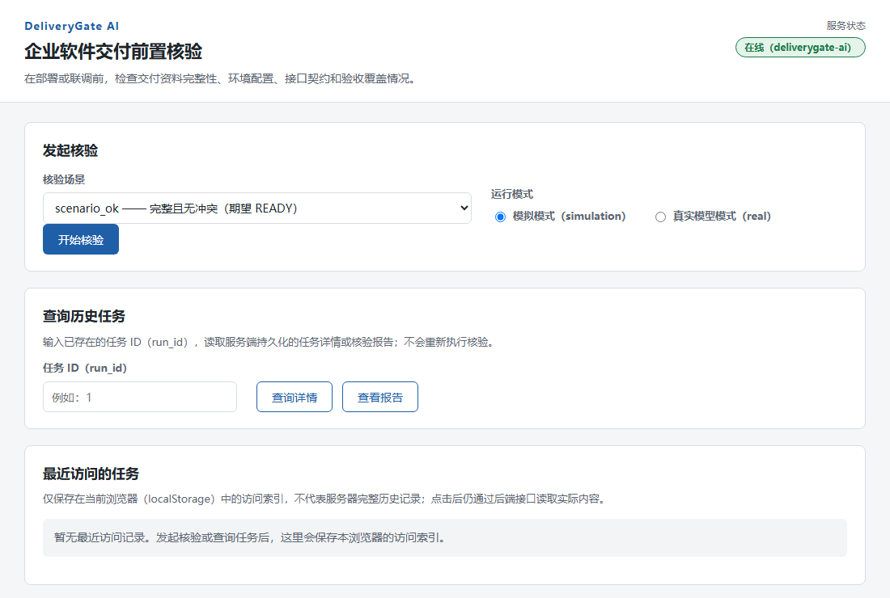
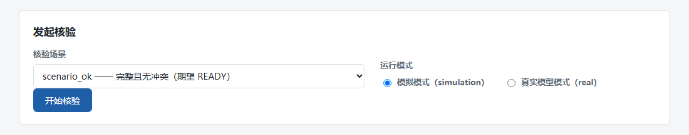
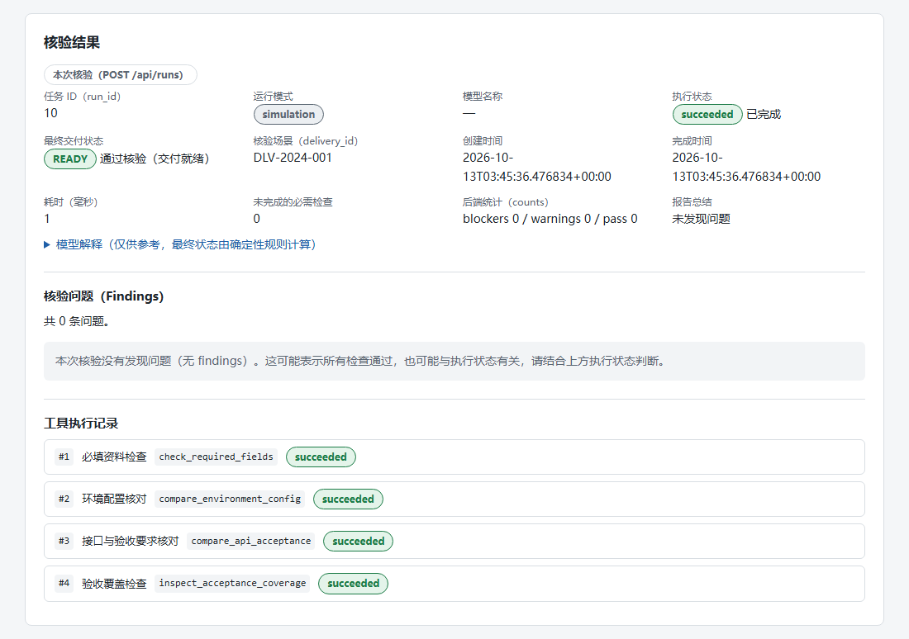
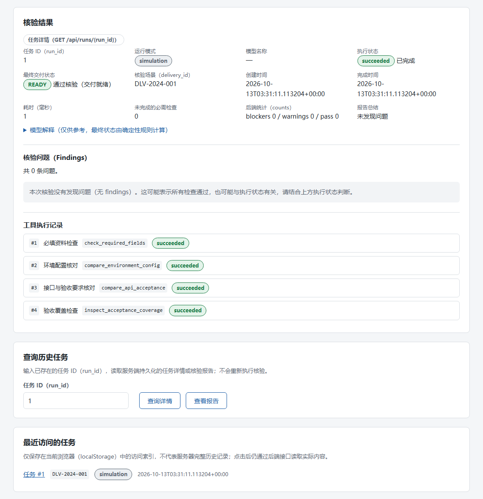
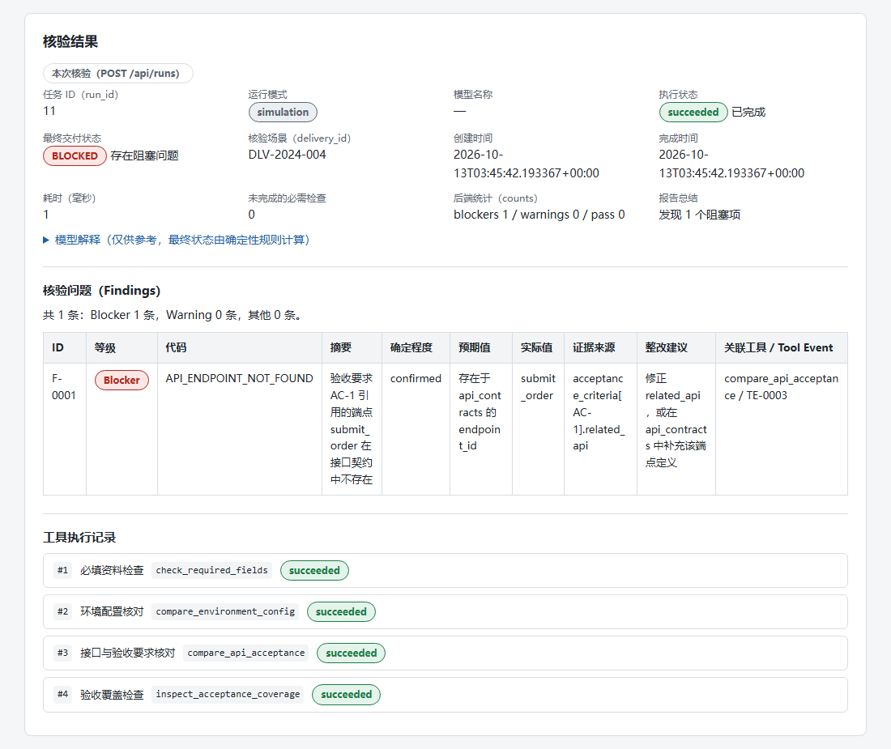
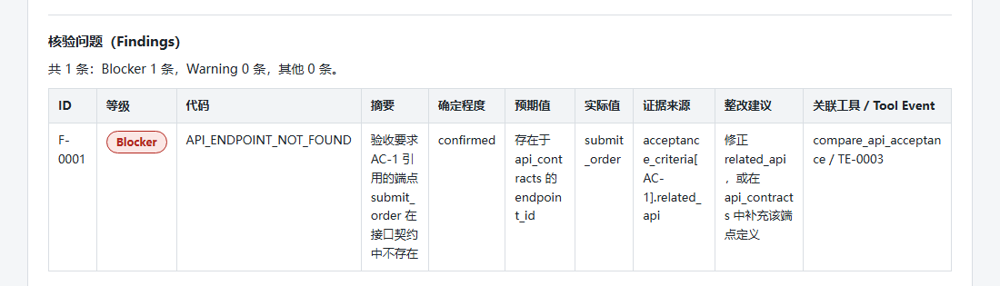
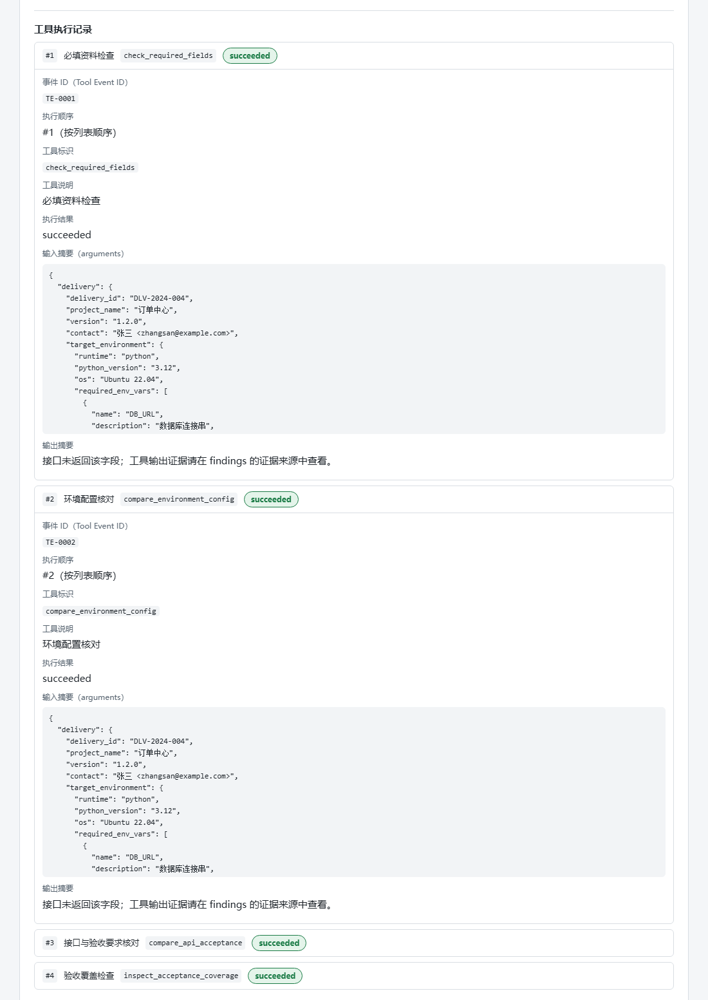
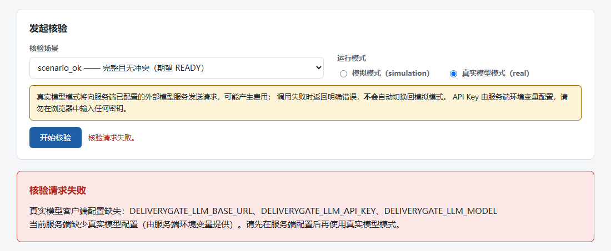
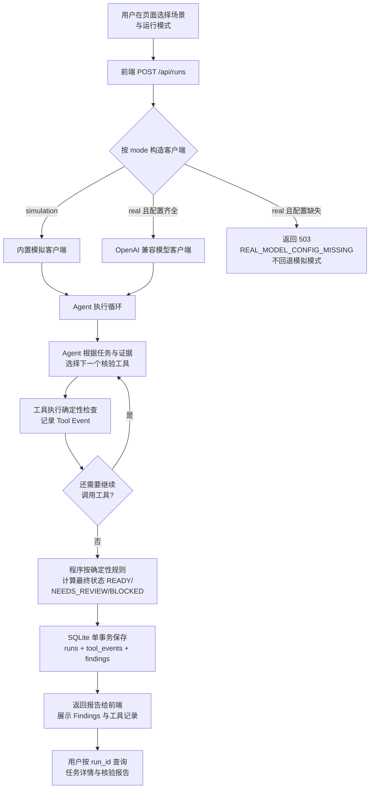

# DeliveryGate AI 图文使用指南

这份指南面向第一次使用 DeliveryGate AI 的读者。你不需要读过项目源代码，也不需要了解 Agent 技术，只要按照章节顺序在 PowerShell 和浏览器里操作，就能完成一次软件交付前置核验并读懂报告。

阅读建议：

- 第一次使用：按第二章 → 第三章 → 第四章 → 第五章 顺序操作。
- 想知道能检查什么：读第一章和第六章。
- 拿到结果看不懂：读第七章。
- 想接入真实大模型：读第八章（会产生费用，请先读注意事项）。
- 出问题了：直接翻第十章。

本指南中的所有命令、页面截图和核验结果，都来自当前项目的真实运行。截图使用项目内置的模拟模式（Simulation）生成，未使用真实 API Key。

## 第一章 这是什么工具？

### 1.1 它解决什么问题

企业软件在部署或联调**之前**，实施人员通常要人工检查一批交付资料：必填信息齐不齐、目标环境和实际部署环境是否一致、接口定义和验收要求能不能对上、每条关键验收要求有没有对应的验证步骤。这些检查繁琐但重要，漏掉一条就可能在上线当天才暴露问题。

DeliveryGate AI 就是一个在**交付前**帮你完成这批检查的工具。它读取一份结构化的交付资料，自动执行四项确定性检查，最后生成一份带有问题证据和整改建议的核验报告。

### 1.2 它适合用在哪个环节

它用在"部署或联调之前"的资料评审环节。例如：

> 实施人员准备上线一个企业软件，怀疑环境配置、接口说明和验收要求可能存在问题。用 DeliveryGate AI 提前检查这些资料，几分钟内得到一份列明问题、证据来源和整改建议的核验报告，再决定是否推进上线。

### 1.3 它能检查什么

工具会执行四项固定检查（四项都是必做项，不可删减）：

1. **必填资料检查**（`check_required_fields`）：交付资料的必填字段（如联系人、接口契约、验收要求等）是否缺失或为空。
2. **环境配置核对**（`compare_environment_config`）：目标环境要求与实际部署环境是否一致（运行时、操作系统、必需环境变量）。
3. **接口与验收要求核对**（`compare_api_acceptance`）：验收要求引用的接口是否存在于接口契约中、版本和认证方式是否清楚。
4. **验收覆盖检查**（`inspect_acceptance_coverage`）：每条验收要求（尤其是关键验收要求）是否都配了对应的验证步骤。

### 1.4 它不能替你做什么

按当前项目的设计与实现，它**不会**：

- 不自动部署软件，不接触任何生产环境；
- 不解析 PDF、Word 等自由格式文档（只读取结构化的交付资料）；
- 不做登录、权限和多租户；
- 不代替人工做最终的上线决策——报告是辅助，决策仍然由人来做；
- 不保证核验通过就等于生产环境一定没问题。

### 1.5 一次核验会产生什么结果

一次核验会得到：

- 一个**任务 ID**（run_id），用于以后查询这次核验；
- 一个**执行状态**（程序有没有跑完）；
- 一个**最终交付状态**（`READY` / `NEEDS_REVIEW` / `BLOCKED`，见第七章）；
- 一份 **Findings 问题列表**，每条问题带证据来源和整改建议；
- 一份**工具执行记录**，能看到 Agent 实际调用了哪些检查工具；
- 一份完整**核验报告**，保存在服务端数据库里，随时可查。

### 1.6 本指南用到的术语

| 术语 | 一句话解释 | 在本项目中的含义 |
| --- | --- | --- |
| Agent | 能根据当前检查结果决定下一步调用什么工具的程序 | 读取交付资料后，依次决定调用哪个核验工具、何时结束 |
| 核验工具 | 负责执行某一项具体检查的程序 | 四个固定工具，见 1.3 节，检查逻辑是确定性的 Python 代码 |
| Simulation（模拟模式） | 使用项目内置模拟客户端完成演示，不调用真实大模型 | 默认模式，不需要 API Key，不会访问外部模型服务 |
| Real（真实模型模式） | 使用你配置的真实 OpenAI 兼容模型服务来决策 | 需要服务端配置环境变量，可能产生 API 费用 |
| Finding | 一次核验发现的问题或风险 | 报告表格中的一行，有 ID、等级、证据和整改建议 |
| Tool Event | Agent 实际执行某个检查工具时产生的一条记录 | 结果页"工具执行记录"中的一条，有 TE-xxxx 编号 |
| run_id | 一次核验任务的唯一编号 | 查询历史任务时输入的就是它，例如 `1` |

## 第二章 使用前需要准备什么？

### 2.1 环境要求

本项目当前在 Windows + PowerShell 环境下开发和验证。开始前请确认：

| 准备项 | 要求 | 说明 |
| --- | --- | --- |
| 操作系统 | Windows（已在 Windows 上完整验证） | 本指南命令全部以 PowerShell 为准 |
| Python | 3.12 | 项目技术栈为 Python 3.12（README 标注） |
| 依赖库 | `requirements.txt` 中的 6 个包 | 一条命令安装，见 2.3 |
| 浏览器 | 任一现代浏览器 | 本指南截图来自 Microsoft Edge |
| Node.js | **不需要** | 前端是纯 HTML/CSS/JS，无构建步骤；Node 只在开发时用于语法检查 |
| API Key | **不需要** | 模拟模式不调用真实模型，第八章才会用到 |

### 2.2 检查 Python 是否可用

打开 PowerShell，输入：

```powershell
python --version
```

如果显示 `Python 3.12.x` 即可继续。如果提示"无法将 python 项识别为 cmdlet"，说明 Python 未安装或未加入 PATH，请先安装 Python 3.12 并勾选"Add to PATH"，然后重开 PowerShell 再试。

### 2.3 进入项目目录并安装依赖

```powershell
cd D:\售前项目\deliverygate-ai
python -m pip install -r requirements.txt
```

项目没有规定必须使用虚拟环境，以上命令直接安装到当前 Python 环境即可（与 README 的"跑起来"一节一致）。

`requirements.txt` 包含：fastapi、uvicorn、pydantic、httpx、PyYAML、pytest。全部安装成功后，可以先跑一遍测试确认环境正常（可选，但推荐）：

```powershell
python -m pytest
```

预期看到 `209 passed`。测试全部在本地运行，不访问网络、不需要 API Key。

### 2.4 第一次运行前的注意事项

1. **不需要配置任何环境变量**。模拟模式开箱即用。
2. **数据库会自动创建**。第一次发起核验时，程序会在项目 `data/` 目录下自动创建 `deliverygate.db`（SQLite 数据库文件），不需要手动建库。
3. **`.env` 文件不是必需的**。项目根目录提供 `.env.example` 作为字段参考；只有你想用真实模型模式时才需要配置环境变量（见第八章）。`.env` 已被 `.gitignore` 忽略，切勿把真实密钥提交进 Git。
4. **端口默认 8000**。如果 8000 端口被其他程序占用，启动会报错，处理方法见第十章。

## 第三章 如何启动系统？

### 3.1 逐步启动

**第 1 步：打开 PowerShell。**

**第 2 步：进入项目目录。**

```powershell
cd D:\售前项目\deliverygate-ai
```

**第 3 步：安装依赖**（首次必须，之后可跳过）。

```powershell
python -m pip install -r requirements.txt
```

**第 4 步：配置可选环境变量**（模拟模式跳过本步）。

只有使用真实模型模式时才需要，详见第八章。请记住：环境变量要配置在**运行服务的这个 PowerShell 窗口**里，不是配置在浏览器里。

**第 5 步：启动 FastAPI 服务。**

```powershell
python -m uvicorn app.main:app --reload
```

启动成功后终端会显示类似内容：

```
INFO:     Uvicorn running on http://127.0.0.1:8000 (Press CTRL+C to quit)
INFO:     Application startup complete.
```

几点说明：

- 这条命令**必须在项目根目录**（`D:\售前项目\deliverygate-ai`）执行，因为程序按 `app.main` 这个模块名找入口，`app/` 文件夹就在项目根目录下。
- `--reload` 表示改了代码会自动重启服务，开发时很方便。
- 服务地址是 `http://127.0.0.1:8000`，端口是 **8000**。

**第 6 步：打开浏览器访问首页。**

访问：

```
http://127.0.0.1:8000/
```

**第 7 步：确认页面显示服务在线。**

页面右上角"服务状态"徽章显示绿色的 **在线（deliverygate-ai）**，说明前后端都正常（如下图第四章图中的第 ① 区域）。如果显示"离线 / 不可达"，请按第十章排查。

**第 8 步：正确停止服务。**

回到启动服务的 PowerShell 窗口，按 `Ctrl + C`。看到 `Shutting down`、`Application shutdown complete` 后服务即停止。直接关掉窗口也能停服务，但推荐用 `Ctrl + C`，可以正常释放端口。

### 3.2 必须记住的三件事

1. **终端窗口要保持打开**。服务跑在这个窗口里，窗口关了服务就停了。
2. **浏览器地址是 `http://127.0.0.1:8000/`**（`127.0.0.1` 也可以换成 `localhost`）。
3. **重新打开浏览器页面不会丢失已保存的核验任务**——任务存在服务端数据库里，刷新后可以用任务 ID 重新查询（见第九章）。

## 第四章 认识主页面

启动服务并访问 `http://127.0.0.1:8000/` 后，会看到下面这个中文核验工作台。



**图 4-1　系统首页**：从上到下依次是服务状态、发起核验、查询历史任务、最近访问的任务四个区域。请确认右上角第 ① 区域显示绿色"在线"徽章，再进行后续操作。

页面主要区域说明（按编号）：

| 编号 | 区域 | 作用 |
| --- | --- | --- |
| ① | 顶部服务状态 | 显示"在线（deliverygate-ai）"表示服务正常；"离线 / 不可达"表示连不上服务 |
| ② | 核验场景下拉框 | 选择要核验的场景，每项格式为 `场景 ID —— 名称（期望 状态）` |
| ③ | 运行模式单选按钮 | 在"模拟模式（simulation）"和"真实模型模式（real）"之间切换，默认模拟模式 |
| ④ | 开始核验按钮 | 提交核验请求；按钮旁的状态文字会显示"正在执行核验…→核验完成：任务 #N…" |
| ⑤ | 核验结果区域 | 核验完成后出现（发起核验下方），包含任务元信息、Findings 表格和工具执行记录 |
| ⑥ | 查询历史任务 | 输入任务 ID（run_id），点"查询详情"或"查看报告"读取服务端已保存的任务 |
| ⑦ | 最近访问的任务 | 当前浏览器本地保存的访问索引（localStorage），**不是**服务器完整历史记录 |

几点说明：

- **② 场景下拉框**：首次加载时会短暂显示"加载中…"，正常加载后列出五个内置场景（见第六章）。如果显示"场景加载失败"，说明前端没取到 `/api/scenarios`，见第十章。
- **④ 开始核验**：核验是**同步**执行的——点击后页面等待服务端跑完才显示结果，模拟模式通常几秒内完成。
- **⑤ 结果区域**在首次核验、查询详情、查看报告三种操作后都会显示，右上角的徽章会标明数据来源（"本次核验（POST /api/runs）"等）。
- 页面语言、状态名称和错误提示均为中文；`READY`、`BLOCKED`、`simulation` 等英文标识是程序内部的固定取值，本指南第七章会逐一解释。

### 场景选择区域放大

下图是"发起核验"卡片的放大视图：左侧选择核验场景，右侧选择运行模式（默认已选中模拟模式），点击左下角蓝色"开始核验"提交。



**图 4-2　发起核验区域**：核验场景下拉框已选中 `scenario_ok —— 完整且无冲突（期望 READY）`，运行模式默认选中"模拟模式（simulation）"。第一次使用请保持默认的模拟模式。

## 第五章 第一次完成核验

本章带你用模拟模式从头到尾跑两次真实核验：先跑一个**通过**的场景（`scenario_ok`，预期 READY），再跑一个**发现阻塞问题**的场景（`scenario_api_conflict`，预期 BLOCKED）。两次操作的页面截图均来自真实运行结果。

### 5.1 第一次核验：`scenario_ok`（预期通过）

**第 1 步：选择核验场景。**

在"发起核验"卡片中，点击"核验场景"下拉框，选择：

```
scenario_ok —— 完整且无冲突（期望 READY）
```

**第 2 步：选择 Simulation 模式。**

保持"运行模式"选中 **模拟模式（simulation）**（默认选中，不用改）。这个模式不调用外部模型、不需要 API Key。

**第 3 步：点击"开始核验"。**

点击蓝色的 **开始核验** 按钮。按钮会短暂变灰（防止重复点击），按钮旁边出现状态文字：

```
正在执行核验（模拟模式通常数秒内完成）…
```

**第 4 步：等待请求完成。**

模拟模式通常几秒内完成。完成后状态文字变为：

```
核验完成：任务 #10（simulation / 执行状态 succeeded / 最终状态 READY）
```

（任务编号是你自己的运行产生的序号，不一定是 10。）

**第 5 步：查看任务 ID。**

结果区域"任务 ID（run_id）"一栏就是这次任务的编号，**请记下来**——以后查询这次核验全靠它（第九章）。

**第 6 步：阅读执行状态和最终交付状态。**

结果区域顶部的元信息网格中，重点看两行（见下图）：

- **执行状态**：`succeeded`，旁边标注"已完成"——表示核验程序正常跑完了。
- **最终交付状态**：`READY`，旁边标注"通过核验（交付就绪）"——表示没有发现问题。



**图 5-1　`scenario_ok` 核验结果**：数据来源徽章显示"本次核验（POST /api/runs）"；执行状态 `succeeded`，最终交付状态 `READY`；后端统计为 blockers 0 / warnings 0；"未完成的必需检查"为 0。请重点看"最终交付状态"和"后端统计"两处。

**第 7 步：查看问题列表。**

往下滚动到"核验问题（Findings）"。本次显示"共 0 条问题"，并有一行说明文字：没有发现问题**也可能**与执行状态有关，要结合上方执行状态一起判断。对 `scenario_ok` 来说，执行状态 `succeeded` + 最终状态 `READY` + 0 条问题，三者一致，可以放心。

**第 8 步：展开工具执行记录。**

继续往下是"工具执行记录"，共有 4 条，对应四项必做检查：

```
#1 必填资料检查          check_required_fields          succeeded
#2 环境配置核对          compare_environment_config     succeeded
#3 接口与验收要求核对    compare_api_acceptance         succeeded
#4 验收覆盖检查          inspect_acceptance_coverage    succeeded
```

点击任意一条的标题行即可展开，展开内容见 5.2 节第 9 步。

**第 9 步（第二次运行时做）：查看证据来源与整改建议。**

带着问题的核验才有"证据"可看。继续做 5.2 节的第二次核验，在 Findings 表格里查看"证据来源""预期值 / 实际值""整改建议"三类信息。

**第 10 步：打开核验报告。**

滚动到页面下方的"查询历史任务"卡片：

1. 在"任务 ID（run_id）"输入框中填入第 5 步记下的编号（如果你是跟着本指南操作，此时可能是 `10`；下面图例是查询任务 `1` 的真实截图）；
2. 点击 **查看报告** 按钮；
3. 结果区域右上角的来源徽章变为 **核验报告（GET /api/runs/{run_id}/report）**，显示的内容与刚核验完的结果一致——这就是保存在服务端数据库里的正式报告。



**图 5-2　查询历史任务**：输入任务 ID 后点"查询详情"或"查看报告"，上方结果区域会刷新为服务端保存的数据（本图来源徽章为"任务详情（GET /api/runs/{run_id}）"）。下方"最近访问的任务"列表会自动记住你刚刚查询过的任务，方便下次点击。

### 5.2 第二次核验：`scenario_api_conflict`（预期发现阻塞）

**第 1 步：切换场景。**

在"核验场景"下拉框中选择：

```
scenario_api_conflict —— 接口契约与验收要求引用冲突（期望 BLOCKED）
```

**第 2 步：保持模拟模式，点击"开始核验"。**

几秒后状态文字变为：

```
核验完成：任务 #11（simulation / 执行状态 succeeded / 最终状态 BLOCKED）
```

注意：**执行状态依然是 `succeeded`（已完成），但最终交付状态是 `BLOCKED`。** 这不矛盾——程序正常跑完了，只是核验发现了一个阻碍交付的问题。详见第七章。

**第 3 步：查看 BLOCKED 结果。**



**图 5-3　`scenario_api_conflict` 核验结果**：最终交付状态 `BLOCKED`（红色徽章），后端统计 blockers 1 / warnings 0，报告总结"发现 1 个阻塞项"。执行状态仍为 `succeeded`——核验流程本身没有出错。

**第 4 步：查看 Findings 表格与证据来源。**

"核验问题（Findings）"区域显示"共 1 条：Blocker 1 条，Warning 0 条"。表格如下：



**图 5-4　Findings 表格**：每条问题包含 ID（`F-0001`）、等级（Blocker）、代码（`API_ENDPOINT_NOT_FOUND`）、摘要、确定程度、预期值、实际值、证据来源、整改建议、关联工具 / Tool Event 十列。本条的证据来源是 `acceptance_criteria[AC-1].related_api`——即验收要求 AC-1 里引用的接口。

这条问题的含义用大白话说：验收要求 AC-1 写着要调用 `submit_order` 接口，但接口契约里根本没有这个接口（契约里只有 `create_order`），所以验收无法执行。整改建议是：修正 `related_api`，或在接口契约中补充该端点定义。

**第 5 步：展开工具执行记录。**

点击"工具执行记录"中的条目标题展开详情。展开后可以看到该次工具调用的完整信息：



**图 5-5　展开的工具执行记录**：每条记录包含事件 ID（Tool Event ID，如 `TE-0001`）、执行顺序、工具标识、工具说明、执行结果、输入摘要（arguments）。输入摘要是工具当时收到的完整交付资料 JSON。"输出摘要"一栏明确写着"接口未返回该字段；工具输出证据请在 findings 的证据来源中查看"——工具的输出证据需要到 Findings 表格追溯，这是前后端约定的真实行为，不是页面出错。

**第 6 步（可选）：按 ID 追溯证据链。**

Findings 表格最后一列"关联工具 / Tool Event"给出了 `工具名 / TE-xxxx`（本例 `compare_api_acceptance / TE-0003`）。把它和工具执行记录里的事件 ID 对照，就能形成完整追溯链：

```
问题 F-0001 → 工具执行记录 TE-0003 → 输入摘要（当时的交付资料）→ 证据来源 acceptance_criteria[AC-1].related_api
```

到此，你已经完成了"发起核验 → 读结果 → 查证据 → 调报告"的完整闭环。

## 第六章 五个核验场景有什么区别？

项目内置五个示例核验场景，存放在 `data/sample_packages/` 目录，每个场景是一份结构化的交付资料 YAML。下表依据五个场景文件的真实内容和实际运行结果整理（预期状态已逐一用模拟模式实测验证）：

| 场景 ID | 模拟的情况（资料里埋的问题） | 预期核验结果 | 实测 Findings | 用户为什么应该关注 |
| --- | --- | --- | --- | --- |
| `scenario_ok` | 资料完整、环境一致、接口与验收要求对得上、验证步骤齐全 | `READY` | 0 条 | 作为"健康基线"：先跑通它，确认系统本身工作正常 |
| `scenario_missing` | 联系人字段缺失，且实际部署环境缺少必需的 `DB_URL` 环境变量 | `BLOCKED` | 2 条 Blocker（`MISSING_REQUIRED_FIELD`、`ENV_REQUIRED_VAR_MISSING`） | 漏填资料是最常见也最容易提前发现的问题——上线后才找不到负责人就晚了 |
| `scenario_env_mismatch` | 实际环境 Python 版本 3.11 ≠ 目标 3.12（Blocker），操作系统 CentOS 7 ≠ 目标 Ubuntu 22.04（Warning） | `BLOCKED` | 1 条 Blocker（`ENV_PYTHON_VERSION_MISMATCH`）+ 1 条 Warning（`ENV_OS_MISMATCH`） | 环境不一致是部署失败的高发原因；这个场景同时演示 Blocker 和 Warning 并存 |
| `scenario_api_conflict` | 验收要求 AC-1 引用了接口契约中不存在的 `submit_order` 接口 | `BLOCKED` | 1 条 Blocker（`API_ENDPOINT_NOT_FOUND`） | 文档之间自相矛盾会让验收无法执行，是联调阶段的经典问题 |
| `scenario_coverage_gap` | 验收要求存在，但验证步骤列表为空（关键验收要求 AC-1 没有对应验证步骤） | `BLOCKED` | 2 条 Blocker（`MISSING_REQUIRED_FIELD`、`COVERAGE_CRITICAL_GAP`） | "写了验收要求但没人验证"会让上线验收流于形式 |

页面下拉框中每项的格式为 `场景 ID —— 名称（期望 状态）`，例如 `scenario_missing —— 必需信息缺失（期望 BLOCKED）`，名称取自项目内置的场景目录。

**重要说明**：

1. 这些都是**项目内置的示例核验资料**，用于演示和测试，**不等同于任何真实客户的生产问题**。
2. "期望状态"只是样例的说明性元数据；每次核验的最终状态始终由程序中的确定性规则重新计算（见第七章），不会因为标了期望就直接给出该结果。
3. 第一版只提供这五个预置场景，不支持上传自定义资料，原因见第十一章。
4. 以上"实测 Findings"一列为本次编写指南时用模拟模式逐一运行五个场景得到的真实结果。

## 第七章 如何读懂核验结果？

### 7.1 三个最终交付状态

| 状态 | 页面标签 | 含义 |
| --- | --- | --- |
| `READY` | 通过核验（交付就绪） | 必需核验均已完成，没有阻塞项，符合当前交付就绪规则 |
| `NEEDS_REVIEW` | 需进一步检查或人工确认 | 存在需要进一步确认的警告（Warning）或不确定项 |
| `BLOCKED` | 存在阻塞问题 | 存在阻碍后续交付的关键问题（Blocker），或有必需检查没有成功完成 |

### 7.2 执行状态 ≠ 最终交付状态

这是最容易误解的一对概念，两者**相互独立**：

- **执行状态**（`status` / `run_status`）回答："核验**程序跑完**了吗？"
- **最终交付状态**（`final_status`）回答："**资料**能交付吗？"

最常见的组合：

> `status=succeeded` 且 `final_status=BLOCKED`
> 表示系统已经**完成**核验，但核验**发现了阻塞问题**。它不代表程序崩溃，也不代表交付已经成功。

其他可能出现的执行状态（页面显示中文标签）：

| 执行状态 | 页面标签 | 含义 |
| --- | --- | --- |
| `succeeded` | 已完成 | 核验正常结束 |
| `model_error` | 模型调用失败 | 真实模型模式下模型请求失败；已有证据仍会保存 |
| `tool_error` | 工具执行失败 | 某个检查工具执行出错 |
| `failed` / `internal_error` | 执行失败 / 内部错误 | 其他异常 |

当执行状态不是 `succeeded` 时，结果区域会出现黄色警示框，提示"核验流程未正常完成……执行未完成不等于交付就绪，也不等于核验通过"，并展示后端已返回的部分结果。

### 7.3 最终状态是怎么算出来的

最终交付状态由程序里的**确定性规则**按优先级计算（命中即停，与模型的自然语言回答无关）：

1. 有必需检查没有成功完成 → `BLOCKED`
2. 有确认的 Blocker → `BLOCKED`
3. 有 Warning → `NEEDS_REVIEW`
4. 都没有 → `READY`

相同的资料输入，永远得到相同的结果。**模型不能自己"宣布"READY。**

### 7.4 Blocker 和 Warning 的区别

| | Blocker（阻塞项） | Warning（警告项） |
| --- | --- | --- |
| 严重程度 | 必须解决，否则不建议推进交付 | 需要关注或人工确认，不一定阻塞 |
| 影响 | 直接导致 `BLOCKED` | 导致 `NEEDS_REVIEW`（没有 Blocker 时） |
| 例子 | 缺少必需字段、接口引用不存在、关键验收无验证步骤 | 操作系统与目标不一致等差异项 |

### 7.5 读懂一条 Finding 的各列

- **ID**（如 `F-0001`）：问题在**本次任务内**的编号，用于在报告中引用某条问题。不同任务的编号会重复，不保证跨任务唯一。
- **等级**：`Blocker` / `Warning`，见上表。
- **代码**（如 `API_ENDPOINT_NOT_FOUND`）：机器可读的问题类型标识，便于统计和检索。
- **确定程度**（certainty）：`confirmed`（已确认）或 `uncertain`（不确定，需人工复核）。只有 `confirmed` 的 Blocker 才会触发 `BLOCKED`。
- **预期值 / 实际值**（expected / actual）：规则认为"应该是什么"与资料里"实际是什么"的对照，是判断问题的直接依据。
- **证据来源**（evidence.source）：这条结论是从资料的哪个字段得出的，例如 `acceptance_criteria[AC-1].related_api` 表示"验收要求 AC-1 的 related_api 字段"。它让每条问题都可回溯到原始资料。
- **整改建议**（remediation）：针对这条问题的修改方向（例如"修正 related_api，或在接口契约中补充该端点定义"）。建议由检查规则生成，**是否采纳、如何修改仍需人工判断**。
- **关联工具 / Tool Event**（tool_event_id，如 `TE-0003`）：这条问题由哪次工具执行产生，可到"工具执行记录"中对照查看当时的输入。

### 7.6 模型解释只是辅助说明

结果区域有一个可展开的"模型解释（仅供参考，最终状态由确定性规则计算）"折叠块。它展示模型对本次核验的文字说明，**仅供人阅读参考**：

- 它**不参与**最终状态计算，存进数据库也只是存档；
- 即使模型在解释里写了"READY"，只要规则算出来是 `BLOCKED`，报告就是 `BLOCKED`；
- 模拟模式下这段解释来自内置模拟客户端，不代表任何真实大模型的推理能力。

## 第八章 Simulation 和 Real 模式有什么区别？

### 8.1 一张表看懂差别

| | Simulation（模拟模式） | Real（真实模型模式） |
| --- | --- | --- |
| 谁在做决策 | 项目内置的模拟客户端 | 已配置的 OpenAI 兼容模型服务 |
| 需要 API Key 吗 | **不需要** | 需要（服务端环境变量） |
| 会访问外部服务吗 | 不会，完全本地运行 | 会，向配置的模型服务发送请求 |
| 会产生费用吗 | 不会 | 可能产生 API 费用 |
| 适合场景 | 第一次运行、界面演示、日常开发测试 | 想验证真实模型的工具选择与解释能力 |
| 结果标注 | `simulation` | `real` |
| 代表性 | 只证明**流程和检查规则**工作正常，**不代表真实大模型的推理质量** | 依赖具体模型的工具调用协议支持与实际表现，不同模型可能不同 |
| 失败时的行为 | — | **不会自动切换回模拟模式**，会返回明确错误 |

页面上的规则：核验完成后的状态文字和结果区域"运行模式"一栏都会标注 `simulation` 或 `real`，两者严格区分。**模拟模式跑通不能证明真实模型调用已经通过**——这是两件独立的事。

另外，选择"真实模型模式（real）"时，"开始核验"按钮上方会出现黄色警示框：

> 真实模型模式将向服务端已配置的外部模型服务发送请求，可能产生费用；调用失败时返回明确错误，**不会**自动切换回模拟模式。API Key 由服务端环境变量配置，请勿在浏览器中输入任何密钥。

### 8.2 如何配置真实模型模式

所有配置都在**运行服务的 PowerShell 会话**中通过环境变量完成，字段名与项目 `.env.example` 完全一致：

| 环境变量 | 说明 | 示例（占位符） |
| --- | --- | --- |
| `DELIVERYGATE_LLM_BASE_URL` | OpenAI 兼容接口的 Base URL，**不含** `/chat/completions`（客户端会自动拼接） | `https://your-llm.example.com/v1` |
| `DELIVERYGATE_LLM_API_KEY` | Bearer Token（真实密钥） | `<你的API Key 占位符>` |
| `DELIVERYGATE_LLM_MODEL` | 模型名称 | `<模型名占位符>` |
| `DELIVERYGATE_LLM_TIMEOUT_SECONDS` | 单次请求超时（秒），缺省 30 | `30` |

**PowerShell 配置示例**（请把尖括号内容换成你自己的值，切勿把真实密钥写进文档或提交到 Git）：

```powershell
$env:DELIVERYGATE_LLM_BASE_URL = "<你的模型服务地址>/v1"
$env:DELIVERYGATE_LLM_API_KEY  = "<你的API Key>"
$env:DELIVERYGATE_LLM_MODEL    = "<模型名>"
$env:DELIVERYGATE_LLM_TIMEOUT_SECONDS = "30"
```

然后（重新）启动服务——环境变量要在**启动 uvicorn 之前**设置好，它们由服务端进程读取：

```powershell
python -m uvicorn app.main:app --reload
```

补充说明：

- 也可以参考项目根目录的 `.env.example` 了解字段含义；`.env` 已被 `.gitignore` 忽略，**不要提交真实密钥**。
- 配置好之后，在页面上选择"真实模型模式（real）"并发起核验即可。真实请求失败时会返回明确错误（例如超时、模型服务返回错误），任务以 `run_status=model_error` 保存，已有证据不丢失，也**绝不**静默回退成模拟模式。
- **真实模型调用可能产生费用**，请确认你的模型服务计费方式后再使用。

### 8.3 没有真实模型服务怎么办？

**完全不影响使用本指南。** 模拟模式不需要任何外部服务和密钥，就能完成全部功能：发起核验、查看 Findings 和证据、展开工具记录、查询历史报告。第二章到第七章、第九章的所有操作都不需要真实模型。

### 8.4 真实模式缺少配置时的错误提示

如果你的服务端没有配置上面三个必需环境变量，选择 real 模式点击"开始核验"会得到 HTTP 503 错误（这是**正常的安全行为**，不是程序坏了）：



**图 8-1　真实模型配置缺失**：结果区域显示红色"核验请求失败"卡片，明确列出缺失的环境变量名（`DELIVERYGATE_LLM_BASE_URL`、`DELIVERYGATE_LLM_API_KEY`、`DELIVERYGATE_LLM_MODEL`），并提示"请先在服务端配置后再使用真实模型模式"。注意：错误卡片**只回传变量名，不回传任何变量值或密钥**。

## 第九章 如何查询历史任务和报告？

每次核验完成后都会保存在服务端 SQLite 数据库里，随时可以重新查询。查询有两种入口：

### 9.1 从"最近访问"列表打开

页面底部的"最近访问的任务"会自动记录你最近发起或查询过的任务（最多 10 条），点击列表中的任务链接，前端会用该任务的 run_id **重新从服务端读取**实际内容并显示在结果区域。

### 9.2 手动输入 run_id 查询

在"查询历史任务"卡片中：

1. 输入任务 ID（必须是正整数，例如 `1`）；
2. 点击 **查询详情**：调用 `GET /api/runs/{run_id}`，返回执行状态、最终状态、工具事件、findings——**只读，不会重新执行核验**；
3. 点击 **查看报告**：调用 `GET /api/runs/{run_id}/report`，返回带 `F-xxxx` 编号、`tool_event_id` 与证据来源追溯链的完整核验报告。

两个按钮的区别：详情适合快速看状态，报告是归档格式的完整内容。对已完成的任务，两者展示的信息高度一致，结果区域右上角的来源徽章会标明你刚才用的是哪个接口。

### 9.3 刷新页面后为什么还能读到？

因为**数据存在服务端**：任务保存在服务器的 SQLite 数据库里，不依赖任何页面状态。刷新页面、换一个浏览器、甚至重启服务再打开，只要数据库文件还在，输入 run_id 就能查到。

### 9.4 "最近访问"列表和服务器历史记录的区别

| | 最近访问的任务列表 | 服务器数据库历史 |
| --- | --- | --- |
| 存放位置 | 当前浏览器的 localStorage（本地） | 服务端 SQLite 数据库文件 |
| 容量 | 最多 10 条访问索引 | 全部历史任务 |
| 换浏览器/设备 | **看不到**（只存在原浏览器里） | 输入 run_id 即可查到 |
| 是否包含任务内容 | 不含，只存 run_id、场景、模式、时间几个索引字段 | 包含完整的详情、findings、工具事件和报告 |

因此：**"最近访问"只是本机的快捷访问索引，不是服务器的完整历史列表。** 反过来说——

- **清除浏览器本地数据（localStorage）只会清掉"最近访问"列表，不会删除服务器上的任何核验任务。** 服务器数据还在，手动输入 run_id 照样能查。
- 想要找回之前某次任务但忘了编号：run_id 是从 1 开始递增的整数，可以依次试 `1`、`2`、`3`……；也可以直接查数据库文件。

## 第十章 常见问题排查

每个问题按 **看到什么现象 → 常见原因 → 如何检查 → 建议怎么解决** 的结构说明。涉及具体错误码的地方均来自当前代码的真实定义。

### 10.1 Python 命令不可用

**看到什么现象**：输入 `python --version` 提示"无法将 python 项识别为 cmdlet、脚本或可运行的程序"，或弹出 Microsoft Store。

**常见原因**：Python 未安装；安装时没勾选"Add python.exe to PATH"；`python` 被 Windows Store 别名占位。

**如何检查**：在 PowerShell 运行 `where.exe python`，看返回的路径是不是你安装的 Python；运行 `py --version` 看是否可用。

**建议怎么解决**：重新安装 Python 3.12 并勾选 Add to PATH；或改用 `py -m uvicorn ...` 形式执行（`py` 是 Windows Python 启动器）；安装后关闭并重开 PowerShell 让 PATH 生效。

### 10.2 依赖安装失败

**看到什么现象**：`python -m pip install -r requirements.txt` 报红色错误、长时间无进展，或安装后 `python -m pytest` 提示找不到模块。

**常见原因**：网络不通或 pip 源访问慢；Python 版本过旧（需要 3.12）；装到了多个 Python 环境中的另一个。

**如何检查**：运行 `python -m pip --version`，确认 pip 所属路径与 `python --version` 的安装路径一致；重新运行安装命令并完整阅读第一条错误信息。

**建议怎么解决**：确认 Python 为 3.12；重试安装（网络波动是常见原因）；确保始终用 `python -m pip` 而不是单独的 `pip`，保证装进当前 Python 环境。

### 10.3 服务启动失败

**看到什么现象**：运行 `python -m uvicorn app.main:app --reload` 后报 `ModuleNotFoundError: No module named 'app'`，或提示端口被占用。

**常见原因**：不在项目根目录执行（找不到 `app` 模块）；8000 端口已被其他程序占用；依赖没装全。

**如何检查**：

- 看当前终端路径是不是 `D:\售前项目\deliverygate-ai`（`app` 文件夹必须在当前目录下）；
- 若报 `error while attempting to bind on address ... only one usage of each socket address`，说明端口被占；
- 运行 `python -c "import fastapi"` 验证依赖是否装好。

**建议怎么解决**：先 `cd D:\售前项目\deliverygate-ai` 再启动；端口被占用时，找到并关闭占用 8000 端口的旧进程（或重开一个终端确认没有残留的 uvicorn），当前代码的启动命令默认使用 8000 端口；依赖问题重跑 10.2 的安装命令。

### 10.4 浏览器提示无法连接

**看到什么现象**：打开 `http://127.0.0.1:8000/` 显示"无法访问此网站 / 站点无法连接"；或页面能打开但右上角显示"离线 / 不可达"、下方出现"健康检查失败：…"。

**常见原因**：服务没启动或已经停止；启动窗口被关闭；地址或端口输入错误；页面打开后服务才停。

**如何检查**：回到启动服务的终端，确认还停在 `Uvicorn running on http://127.0.0.1:8000` 且没有退回到命令提示符；在 PowerShell 里运行 `Invoke-WebRequest http://127.0.0.1:8000/api/health -UseBasicParsing | Select-Object -Expand Content`，正常会返回 `{"status":"ok","service":"deliverygate-ai"}`。

**建议怎么解决**：重新启动服务（第三章第 5 步）后刷新页面；核对地址必须是 `http://127.0.0.1:8000/`（注意是 http 不是 https，端口 8000 不能少）。

### 10.5 场景列表加载失败

**看到什么现象**：场景下拉框显示"场景加载失败"，旁边红色提示"场景列表加载失败：…"。

**常见原因**：服务端 `/api/scenarios` 接口出错；`data/sample_packages/` 目录下的场景 YAML 文件缺失或损坏。

**如何检查**：浏览器直接访问 `http://127.0.0.1:8000/api/scenarios`。正常会返回 JSON 数组（含五个场景）；若返回错误，看 `error.code`：`SCENARIO_LOAD_ERROR` 表示服务端读取场景文件失败。

**建议怎么解决**：确认 `data/sample_packages/` 下五个 `scenario_*.yaml` 文件存在且完整（若被误删，从 Git 历史恢复）；接口返回 500 时查看运行服务的终端里的服务端日志定位具体原因。

### 10.6 真实模式提示缺少模型配置

**看到什么现象**：选"真实模型模式（real）"点开始核验，出现红色"核验请求失败"卡片，提示"真实模型客户端配置缺失：DELIVERYGATE_LLM_BASE_URL、DELIVERYGATE_LLM_API_KEY、DELIVERYGATE_LLM_MODEL"（HTTP 503，错误码 `REAL_MODEL_CONFIG_MISSING`）。

**常见原因**：服务端（PowerShell 会话）没有设置这三个必需环境变量；或设置了但**在启动 uvicorn 之后**才设，进程读不到；或变量名拼写错误。

**如何检查**：在**启动服务的那个**窗口运行 `Get-ChildItem Env:DELIVERYGATE_LLM_*`，确认三个必需变量存在且非空。

**建议怎么解决**：按第八章 8.2 节设置三个必需变量后**重启服务**再试。注意这是刻意设计的安全行为：配置缺失时**不会**自动回退模拟模式，错误信息也只回传变量名、不回传密钥值。如果你只是想演示，请改用模拟模式，无需任何配置。

### 10.7 模型请求超时或返回错误

**看到什么现象**：真实模式下核验失败；结果查询显示执行状态为 `model_error`（页面标签"模型调用失败"），或前端直接显示请求失败。

**常见原因**：模型服务地址/网络不通；`DELIVERYGATE_LLM_TIMEOUT_SECONDS`（默认 30 秒）内没返回；模型服务返回了非预期格式；模型不支持所需的工具调用协议。**注意：本项目的真实模型冒烟测试尚未实际执行过，真实模式下的表现需自行验证，不能以模拟模式结果推断。**

**如何检查**：读运行服务终端里的服务端日志（完整错误只记录在服务端，不会返回给浏览器）；确认 BASE_URL 不含 `/chat/completions`、模型名正确；用同一组配置手工请求模型服务验证连通性。

**建议怎么解决**：修正环境变量并重启服务；网络慢可调大超时（如 `$env:DELIVERYGATE_LLM_TIMEOUT_SECONDS = "60"` 后重启）；换用支持 OpenAI Chat Completions 工具调用协议的模型。失败的任务会以 `run_status=model_error` 落库并保留已有证据，可查询该任务确认保存了哪些结果。**失败时不会静默切换到 Simulation**——如果你在结果里看到 `simulation` 标注，就说明这次根本没有调用真实模型。

### 10.8 查询的 run_id 不存在

**看到什么现象**：查询状态行显示"查询失败：任务不存在：N"（错误码 `RUN_NOT_FOUND`，HTTP 404）；或输入非数字时提示"任务 ID 必须是正整数"、为空时提示"请输入任务 ID 后再查询"。

**常见原因**：编号记错或输入了不存在的编号；数据库被删除/换过（run_id 会重新从 1 开始）；在**另一台机器/另一个数据库**上查询。

**如何检查**：从 `1` 开始递增尝试；确认查询的服务和当初跑核验的是同一个服务（数据库路径见第十一章）。

**建议怎么解决**：核对任务 ID；如确实换了数据库，旧任务在新库里不存在，无法找回（数据库文件是唯一存储）。"最近访问"列表只存索引，如果列表里的任务也查不到，说明服务端数据库已变更。

### 10.9 报告尚不可用

**看到什么现象**：点"查看报告"提示任务尚未完成、暂无最终报告（HTTP 409，错误码 `REPORT_NOT_READY`）。

**常见原因**：该任务还在执行中、没有完成时间（`finished_at` 为空）。第一版是同步执行，正常提交的请求返回时即已完成，所以这种情况很少见；多出现在数据库里存在未完成任务时。

**如何检查**：先点 **查询详情** 看执行状态：若是 `queued`（排队中）或 `running`（执行中），说明任务确实未完成；若是其他状态请把提示原文与终端日志对照。

**建议怎么解决**：对未完成任务先等它结束或查看详情了解进度；前端也会提示"该任务尚未完成执行，暂时没有最终报告，可先查看任务详情"。若任务状态长时间停在执行中，查看服务端日志并在需要时重新发起一次核验。

### 10.10 核验正常结束，但最终状态为 BLOCKED

**看到什么现象**：状态行是"核验完成：任务 #N（simulation / 执行状态 succeeded / 最终状态 BLOCKED）"，页面也没有红色请求失败卡片。

**常见原因**：**这不是故障**——核验程序正常跑完了，是资料本身存在阻塞问题（或有必需检查未完成）。

**如何检查**：看"核验问题（Findings）"里等级为 Blocker 的条目和"后端统计（counts）"的 blockers 数；再对照第七章的判定规则。`scenario_missing`、`scenario_env_mismatch`、`scenario_api_conflict`、`scenario_coverage_gap` 四个场景按设计就是 BLOCKED。

**建议怎么解决**：按 Findings 的"整改建议"修改交付资料后重新核验；想先验证系统本身是否正常，跑一遍 `scenario_ok`（预期 READY）。**不要**把 BLOCKED 当作程序报错来排查，也不要在没有修复资料的情况下换场景"挑"一个 READY 结果。

### 10.11 为什么 Simulation 能工作，却不能证明真实模型调用已经通过

**看到什么现象**：模拟模式一切正常，于是以为"系统已经接通了大模型"。

**常见原因**：这是对两种模式的误解。模拟模式**根本不发外部请求**，它验证的是流程（API、数据库、界面、四项检查规则、状态计算），不涉及任何模型服务。

**如何检查**：看结果区域"运行模式"标注：`simulation` = 未调用外部模型；`real` = 调用了你配置的模型服务。只有标注 `real` 且 `run_status=succeeded` 的任务，才能说明那次真实调用成功了。

**建议怎么解决**：要验证真实链路，需按第八章配置后**实际发起一次 real 模式核验**并确认成功。请注意：**本项目的真实模型 API 冒烟测试至今没有实际运行过**，本指南中的全部截图和结果都来自 Simulation 模式；在你自己的环境完成 real 模式验证之前，不得认为真实模型链路已经通过。

## 第十一章 数据、密钥和使用限制

### 11.1 数据存放在哪里

核验任务保存在 **SQLite 数据库文件**中（三张表：`runs` 任务、`tool_events` 工具事件、`findings` 问题），路径规则：

- 缺省位置：项目下的 `data/deliverygate.db`（首次发起核验时自动创建）；
- 可用环境变量 `DELIVERYGATE_DB_PATH` 指定其他路径，例如：

```powershell
$env:DELIVERYGATE_DB_PATH = "D:\some\path\my.db"
python -m uvicorn app.main:app --reload
```

环境变量为空或未设置时回落到缺省路径。`data/*.db` 已被 `.gitignore` 忽略，数据库文件**不会**被提交进 Git。数据库只增不删——初始化时使用"如果表不存在才创建"的方式，不会覆盖已有历史数据。

### 11.2 场景示例文件与数据库历史的区别

| | 场景示例（`data/sample_packages/*.yaml`） | 数据库历史（`data/deliverygate.db`） |
| --- | --- | --- |
| 是什么 | 预置的**输入**资料，五个固定示例 | 历次核验的**输出**结果 |
| 会变化吗 | 静态文件，不因核验而改变 | 每次核验新增一条记录 |
| 谁能读 | 开发者可直接查看源文件 | 通过页面查询或 API 读取 |
| 删除后 | 场景列表会缺项（接口返回 `SCENARIO_LOAD_ERROR` 或缺项） | 历史任务无法找回（数据库是唯一存储） |

### 11.3 关于密钥与安全边界

- **API Key 永远只配在服务端环境变量里**，前端页面没有任何输入密钥的地方，也不应该有。浏览器把密钥发给前端等于把密钥交给了每个访问页面的人。
- 服务端的统一错误响应**只回传错误码和消息**，不回传堆栈、API Key 或环境变量值（第八章图 8-1 可以看到：只列出变量名）。
- `.env` 已被 `.gitignore` 忽略；`.env.example` 只含空字段名。**不要把真实密钥写进任何文档、截图或提交。**
- 本指南所有截图均由模拟模式生成，不含任何真实密钥。

### 11.4 第一版为什么只提供预置场景

- 安全考虑：接口只接受白名单内的场景 ID，**不接受任意文件路径、任意工具列表**，从入口上杜绝路径注入和任意文件读取。
- 范围控制：本项目的定位是"交付前置核验"演示与验证，结构化资料的自定义上传、编辑、多人协作都不在第一版目标内（见 `docs/REQUIREMENTS.md` 的非目标清单）。

### 11.5 为什么不能把结果直接当作生产交付保证

- 五个场景都是**内置示例资料**，核验的是示例问题，不是任何真实系统；
- 检查规则覆盖的是资料层面的一致性与完整性，**不探测真实部署环境**（不连数据库、不调接口、不登录系统）；
- 最终状态由固定规则计算，`READY` 的含义是"按当前规则未发现问题"，不等于"生产环境一定没问题"；
- 是否上线、如何整改，最终决策始终由人做出。

### 11.6 当前尚未实现或尚未验证的能力

如实说明（与 README"不做的事"一致）：

- **未实现**：自动部署与生产环境修改、登录权限与多租户、自定义交付资料上传、PDF/Word 文档解析、RAG 与多 Agent 编排、任意 SQL/Shell/文件访问；
- **未验证**：真实模型 API 冒烟测试（`tests/integration`）**尚未实际运行**，真实模型模式的端到端表现未经确认；本指南全部截图来自 Simulation 模式；
- **没有**：安全认证、性能压测数据、生产部署方案——本项目不作此类声明。

## 第十二章 一次核验的完整流程图

下图展示从选择场景到前端展示报告的完整链路（与当前实现一致）：



流程说明：

- 第 4 项必做检查不可删减：必需检查范围由服务端固定，请求无法削减。
- Agent 只负责"选工具、何时结束、写解释"；**最终状态由程序计算**（第七章 7.3），模型解释不参与判定。
- 保存是一个事务：三张表要么全部写入、要么全部回滚，不会留下半截数据。
- 查询详情和报告都是**只读**操作，不会重新执行核验，也不会重新调用模型。
- 图中不含自动部署、客户审批或后台异步任务——当前实现是同步执行，请求返回即任务完成。

---

*本指南基于项目当前实现（阶段 0–5.1）编写，全部命令、接口、状态值、错误码和截图均核对自实际代码与真实运行。若后续版本功能变化，以代码和 README 为准。*


